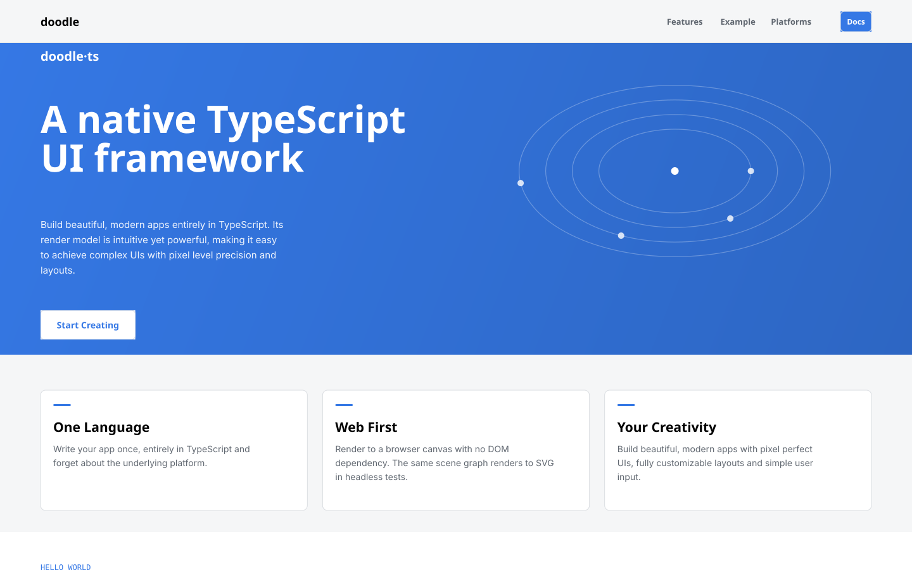
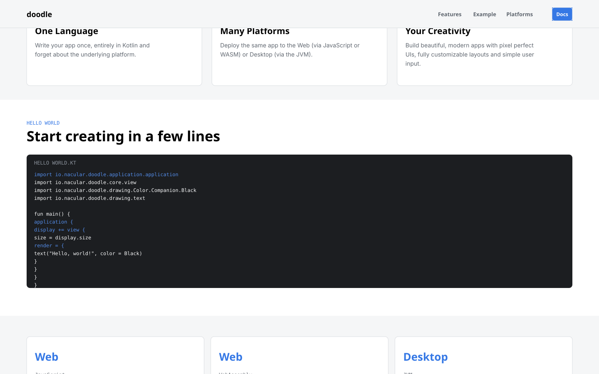
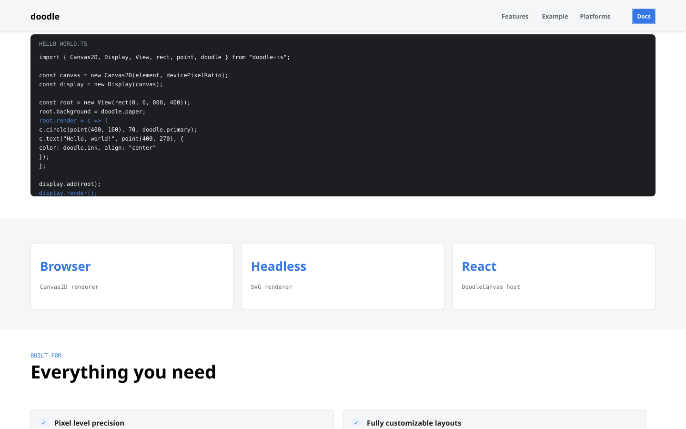
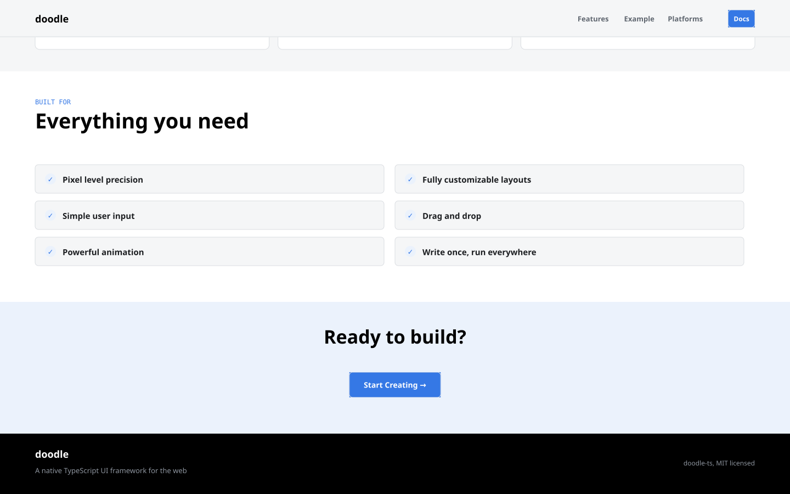

# doodle-ts

[](https://www.typescriptlang.org/)
[](https://react.dev/)
[](LICENSE)
[](CONTRIBUTING.md)

**A native TypeScript UI framework for the web, built on Doodle's rendering model.**

doodle-ts gives you a retained view tree, a vector canvas renderer, composable layout, hit-tested input, animation, a widget catalog and React bindings. It is a web-first implementation: no Kotlin runtime, no Wasm step, no HTML or CSS layout engine required for the parts it draws.



## Contents

- [Why doodle-ts](#why-doodle-ts)
- [Features](#features)
- [Requirements](#requirements)
- [Installation](#installation)
- [Quick start](#quick-start)
- [React usage](#react-usage)
- [How it works](#how-it-works)
- [Examples](#examples)
- [API overview](#api-overview)
- [Project status](#project-status)
- [Contributing](#contributing)
- [License and credits](#license-and-credits)

## Why doodle-ts

The original [Doodle](https://github.com/nacular/doodle) project is written in Kotlin and targets JavaScript, Wasm and the JVM. Its rendering model is worth using on the web directly, without going through Kotlin.

This repository is an independent, web-first TypeScript implementation of that model. It is **not a fork**: upstream code is untouched, and this project has its own language, release cycle, issue tracker and API surface. It is also not a DOM component library. Views draw vectors to a canvas, so React owns the page and doodle-ts owns its rectangle.

Use it when you need custom vector rendering, canvas-heavy product surfaces, data visualizations, design tools or pixel-level control. If you want standard DOM forms, CSS layout and built-in accessibility, a traditional React component library is a better fit. The tradeoffs are documented in [ARCHITECTURE.md](docs/ARCHITECTURE.md).

## Features

- Retained `View` tree with render hooks, invalidation bubbling and transform-aware hit testing
- Vector `Canvas` contract with a DPR-aware browser backend and two headless backends
- Layout managers for fill, center and stack, plus overridable per-section layout
- Pointer, keyboard and wheel input with focus routing, hover states and click synthesis
- `Clock` and seek-safe `Animator` with easings, number and color interpolation, and looping
- Seven canvas-drawn widgets: `Label`, `Button`, `Checkbox`, `Slider`, `TextField`, `Panel`, `Divider`
- React host component and hooks with cleanup on unmount
- Brand tokens sourced from Doodle's own assets, centralized in one file

## Requirements

- Node.js 20 or newer
- React 19 and React DOM 19 when using the React bindings

The engine core is framework agnostic and can be used from plain TypeScript.

## Installation

```bash
npm install doodle-ts
```

For React projects, also install React and React DOM if they are not present:

```bash
npm install doodle-ts react react-dom
```

## Quick start

Render into a real canvas element in the browser:

```ts
import { Canvas2D, Display, View, rect, point, doodle } from "doodle-ts";

const element = document.querySelector<HTMLCanvasElement>("#app")!;
const canvas = new Canvas2D(element, window.devicePixelRatio);
const display = new Display(canvas);
display.resize(element.clientWidth, element.clientHeight);

const root = new View(rect(0, 0, element.clientWidth, element.clientHeight));
root.background = doodle.paper;
root.render = (c) => {
  c.circle(point(element.clientWidth / 2, 160), 70, doodle.primary);
  c.text("Hello from doodle-ts", point(element.clientWidth / 2, 270), {
    color: doodle.ink,
    align: "center",
  });
};

display.add(root);
display.render();
```

For tests or server-side snapshots, swap `Canvas2D` for `SvgCanvas.of(width, height)` and read its `svg` property. Both implement the same `Canvas` interface.

## React usage

Build the Doodle scene graph in a factory, then hand it to `<DoodleCanvas>`:

```tsx
import { useCallback } from "react";
import { DoodleCanvas, type ApplicationContext } from "doodle-ts/react";
import { Panel, Label, Button, StackLayout, doodle, type Application } from "doodle-ts";

function createApp({ display }: ApplicationContext): Application {
  const root = new Panel(doodle.paper);
  root.layoutManager = new StackLayout("vertical", 12, "center", 24);

  root.addChild(
    new Label({
      text: "Hello, world!",
      font: { size: 32, weight: 700 },
      color: doodle.ink,
    }),
    new Button({
      label: "Click me",
      background: doodle.primary,
      textColor: doodle.white,
      onClick: () => console.log("clicked"),
    }),
  );

  display.add(root);
  return { shutdown() {} };
}

export function App() {
  const create = useCallback((context: ApplicationContext) => createApp(context), []);
  return <DoodleCanvas create={create} style={{ width: "100vw", height: "100vh" }} />;
}
```

Hooks are available for finer control: `useView` memoizes a view, `useDoodleView` attaches it to the display for the component lifetime, and `useViewProperty` pushes a React value into a view property.

The complete working version lives in [site/App.tsx](site/App.tsx) and [site/site.ts](site/site.ts).

## How it works

```
  React page
      |
      v
  <DoodleCanvas>          mounts one HTMLCanvasElement
      |
      v
  Display                 owns roots, resize, frames, focus and input routing
      |
      +--> View tree      render hooks, children, transforms, hit testing
      |       |
      |       +--> Layout      fill / center / stack / custom
      |       +--> Widgets     Label, Button, TextField, and others
      |
      +--> Canvas         Canvas2D (browser) or SvgCanvas (headless)
```

`View.draw()` applies the view transform, alpha and clip, paints the background, calls the `render` hook, then recurses into children. Input flows the other way: DOM events are converted to canvas coordinates, hit-tested from the topmost view downward, then bubbled up until a handler consumes them.

Because rendering goes through the `Canvas` interface, the entire demo site can be rendered without a browser and asserted on as SVG text in the test suite.

## Examples

Two runnable examples ship with the repository:

```bash
npm install

npm run dev        # engine and widget demo at http://localhost:5173
npm run dev:site   # Doodle-branded landing page at http://localhost:5173
```

The landing page in `site/` is rendered entirely through one `<DoodleCanvas>`. It includes canvas scrolling, a fixed navigation bar, animated hero art, and a working contact form with an in-canvas toast. There is no DOM UI behind it.





## API overview

| Entry point | Exports |
| --- | --- |
| `doodle-ts` | Geometry, colors, `Canvas` backends, `View`, layouts, clock and animators, `Display`, widgets, `doodle` tokens |
| `doodle-ts/react` | `DoodleCanvas`, `useDoodle`, `useDoodleDisplay`, `useView`, `useDoodleView`, `useViewProperty` |
| `doodle-ts/widgets` | Widget classes and factory helpers |

Type declarations are generated with the package. See [ARCHITECTURE.md](docs/ARCHITECTURE.md) for the layering rules and design decisions.

## Project status

This is a working foundation, not full upstream parity. Implemented today: engine core, seven widgets, React bindings, two examples and a headless render pipeline.

Still open:

- Accessibility layer with a semantic tree, keyboard traversal and screen-reader bridge
- Text input parity for IME composition, spellcheck, autofill and mobile keyboards
- More widgets such as tabs, menus, lists, dialogs, scrollbars and tooltips
- A React reconciler so JSX can declare the scene graph directly
- Published npm release and extended API documentation

## Contributing

See [CONTRIBUTING.md](CONTRIBUTING.md). The required gate is:

```bash
npm run check
```

It runs the strict TypeScript check, the unit tests, the library build and the site build.

## License and credits

MIT. See [LICENSE](LICENSE).

The original [Doodle](https://github.com/nacular/doodle) project is copyright Nacular and licensed MIT. The architecture and brand values in this repository are credited to that project and its documentation. The example copy has been adapted for this web-first implementation. This repository is independent and is not affiliated with or endorsed by Nacular.
